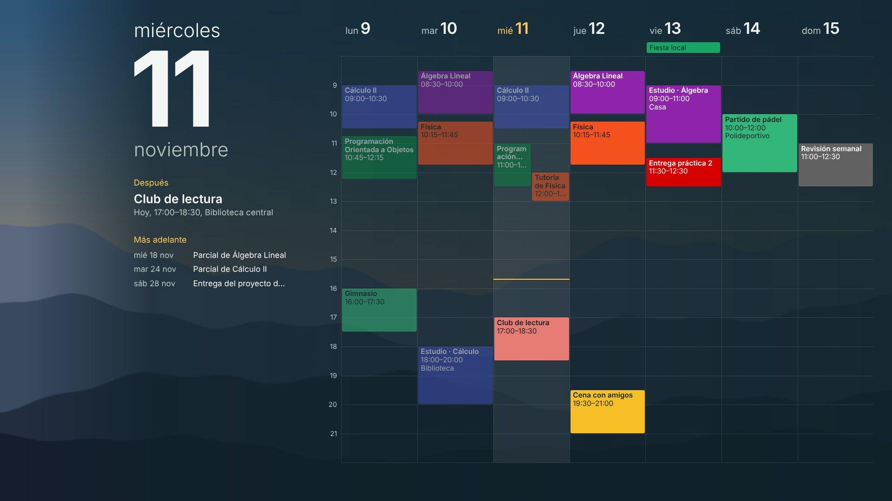
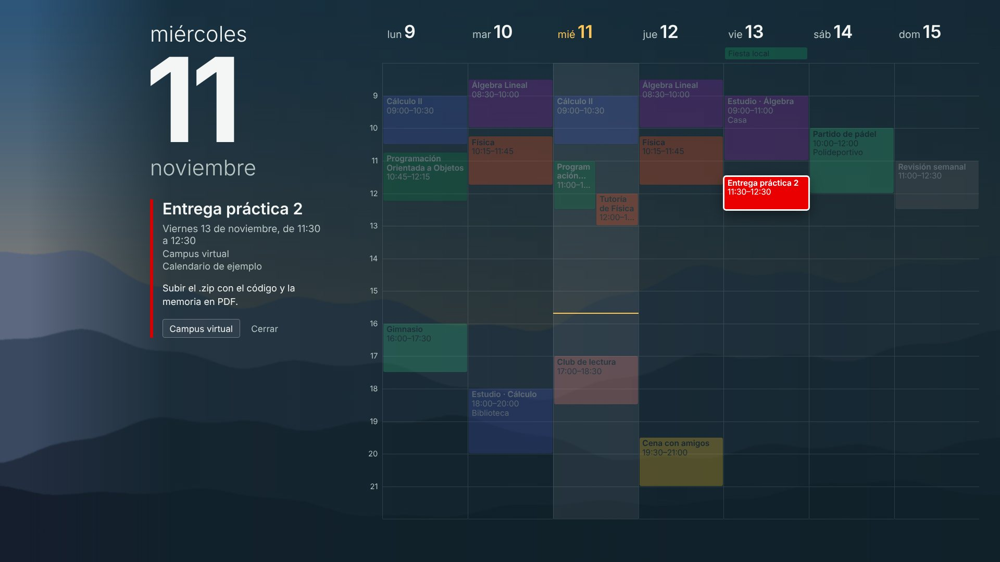
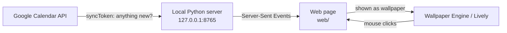

# Live Google Calendar Wallpaper

A live, clickable Google Calendar on your Windows desktop. Changes you make in Google Calendar appear on the wallpaper within seconds; click any event to highlight it and read its description, location and links.

> 🇪🇸 La interfaz está en español. Instrucciones paso a paso en castellano: **[LEEME.md](LEEME.md)**.





<sub>Screenshots use the built-in demo data and a generated background.</sub>

## Features

- **Near real-time sync** with the Google Calendar API: a tiny change check every 15 s using `syncToken`; events are downloaded again only when something actually changed.
- **Instant redraw**: the local server pushes updates to the page with Server-Sent Events, without reloading it.
- **Interactive**: click an event to highlight it, dim the rest and see its date, location, description and links. *Abrir en Google Calendar* opens it in your browser.
- **Your colours**: events keep the colours you chose in Google Calendar; text colour is picked for contrast.
- **Coming up**: one-off events of the next weeks (exams, deadlines) are listed, recurring classes are not.
- **Offline-friendly**: the last data is cached and shown with a notice until the connection is back.
- **One-click reconnect**: if Google's permission expires, a *Volver a conectar* button appears on the wallpaper.
- **Read-only**: the app only asks for `calendar.readonly`; it cannot change your calendar.

## How it works



Windows cannot make a normal wallpaper image clickable, so the calendar is a local web page that a wallpaper host (Wallpaper Engine, or the free Lively Wallpaper) renders behind the desktop icons, forwarding mouse clicks to it.

Google's push notifications (`events.watch`) need a public HTTPS endpoint, which a desktop app does not have. Polling with sync tokens is the practical alternative: an unchanged calendar costs one tiny request per check.

## Try it without Google

```bash
pip install -r requirements.txt
python app.py --demo
```

It opens the page in your browser with an invented week.

## Install on Windows

You need Python 3.10+ and a wallpaper host. Full walkthrough in [LEEME.md](LEEME.md); in short:

1. **Create your own OAuth client** in Google Cloud (free, ~10 min): enable the *Google Calendar API*, set up the consent screen as *External* and create a client of type *Desktop app*.
2. **Run `instalar.bat`.** It asks for the client ID and secret, installs the dependencies in a virtual environment, opens the browser for consent and makes the app start with Windows.
3. **Set `fondo_pantalla/calendario.html` as your wallpaper** in Wallpaper Engine or Lively. This loader waits until the app is running and then opens it, so it also works when the wallpaper host starts first.

`reconectar.bat` renews Google's permission and `desinstalar.bat` removes everything and restores your original wallpaper.

### Why your own Google Cloud project?

This repository contains no Google credentials. Everyone uses their own OAuth client, so nobody depends on anyone else's project or quota, and your calendar data only ever travels between your computer and Google.

While your consent screen is *In testing*, Google expires the permission every 7 days (one click on *Volver a conectar* renews it). Publishing the app removes that limit; Google then asks for a home page and a privacy policy, which you can host with GitHub Pages from the [`docs/`](docs/) folder of your fork.

## Security

- The server listens only on `127.0.0.1` and rejects requests whose `Host` header is not local (protection against DNS rebinding).
- Actions such as opening a link require a custom header, which forces a CORS preflight that the server never grants, so other websites cannot trigger them. Only `http(s)` links that belong to loaded events can be opened.
- Event descriptions (HTML in Google Calendar) are converted to plain text on the server and inserted with `textContent`, never as HTML.
- `credentials.json`, the OAuth token and the event cache stay on your computer and are excluded by `.gitignore`.

## Configuration

`config.json` is created on first run:

| Key | Default | Meaning |
|---|---|---|
| `segundos_comprobacion` | `15` | Seconds between change checks |
| `hora_inicio` / `hora_fin` | `8` / `22` | Visible hours (they grow automatically for earlier or later events) |
| `imagen_fondo` | `""` | Background image path. Empty: your Windows wallpaper at install time |
| `modo` | `"web"` | `"imagen"` renders a static, non-clickable wallpaper image instead |
| `puerto` | `8765` | Local port (also change it in `fondo_pantalla/calendario.html`) |

## Project structure

```
app.py                        Entry point and command line
calendario/
  config.py                   Paths and config.json
  google_calendar.py          OAuth, incremental sync, event conversion and sanitising
  sincronizacion.py           Shared state, sync loop, offline cache, reconnect
  vista.py                    Builds what the page draws (week, now, next, details)
  servidor.py                 Local HTTP server and Server-Sent Events
  windows.py                  Wallpaper, autostart and static image mode
  credenciales.py             Builds credentials.json from the client ID and secret
  demo.py                     Invented week for --demo
web/                          The wallpaper page (HTML, CSS, vanilla JS)
fondo_pantalla/               Loader page to set as wallpaper
tests/                        pytest suite (no Google account needed)
docs/                         Screenshots and GitHub Pages site (home + privacy policy)
instalar.bat, reconectar.bat, desinstalar.bat
```

## Development

```bash
pip install -r requirements-dev.txt
python -m pytest
```

## License

[MIT](LICENSE)
